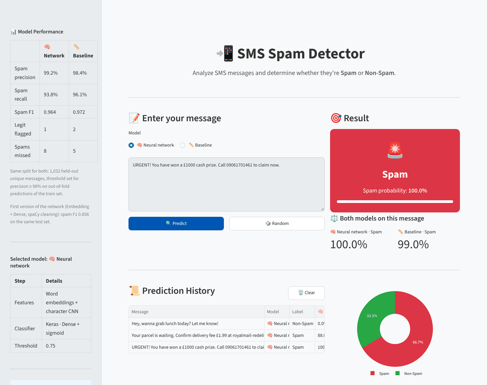

# 📲 SMS Spam Detector

[](https://www.python.org/)
[](https://scikit-learn.org/)
[](https://streamlit.io/)
[](https://www.docker.com/)
[](LICENSE)

A web app that classifies SMS messages as **Spam** or **Non-Spam** in real time, with a spam probability and session analytics.

**[🚀 Live Demo — Hugging Face Spaces](https://cnoret-sms-spam-detector.hf.space/)** · **[☁️ Live Demo — Streamlit Cloud](https://sms-spam-detector-cnoret.streamlit.app/)**



---

## What I Built

- Set up a leak-free evaluation (deduplication, stratified split, threshold chosen on validation) in a reproducible `train.py`
- Compared a **TF-IDF + logistic regression** baseline with the original **word embedding + Dense** network: the simpler model wins and is the one deployed
- Built an interactive **Streamlit** web app with real-time prediction, spam probability, and session history
- Containerized with **Docker** and deployed on both **Hugging Face Spaces** and **Streamlit Cloud**
- Automated syncing between GitHub and Hugging Face with **GitHub Actions**

## Tech Stack

| Layer | Technology |
| --- | --- |
| Model | scikit-learn 1.9 (TF-IDF + logistic regression) |
| Comparison | TensorFlow 2.18, Keras (Embedding + Dense), spaCy |
| Web App | Streamlit 1.44+ |
| Visualization | Plotly |
| Containerization | Docker |
| CI/CD | GitHub Actions → Hugging Face Spaces |

## Data Insights

A few findings from the exploratory analysis (5,572 messages, 87% ham / 13% spam):

**Duplicates** — 414 rows are exact copies of another message (5,158 unique messages). Left in, they put copies of training messages in the test set and inflate the scores, so they are removed before splitting.

**Class imbalance** — The 87/13 split is handled with balanced class weights, and accuracy is not used to pick the model: a model that always answers "non-spam" would already reach 87%.

**Spam messages are nearly twice as long** — Average length: 142 characters for spam vs 74 for ham. Message length alone is a strong signal.

**Most frequent words in spam** — `free`, `txt`, `win`, `claim`, `mobile`, `stop`, `reply`. Classic urgency/reward vocabulary that differs clearly from everyday messages.

## Model

**Protocol** — Duplicates removed, one stratified 80/20 split (4,126 train / 1,032 test), test set used once. The decision threshold is the one that keeps spam precision at 98% or more on out-of-fold predictions of the train set: blocking a legitimate SMS costs more than letting a spam through.

**Deployed model** — TF-IDF on character 2–5-grams + logistic regression with balanced class weights. Character n-grams catch the spellings spammers use (`txt`, `£1000`, phone numbers, short codes) without any text cleaning step. 834 KB, no deep learning dependency.

**Results on the 1,032 held-out unique messages**

| Model | Spam precision | Spam recall | Spam F1 | Legitimate SMS flagged | Spams missed |
| --- | --- | --- | --- | --- | --- |
| **TF-IDF + logistic regression (deployed)** | **0.984** | **0.961** | **0.972** | **2** | **5** |
| Word embedding + Dense network (original) | 0.971 | 0.781 | 0.866 | 3 | 28 |

All numbers are written by `train.py` to [`models/metrics.json`](models/metrics.json), which the app reads.

**What changed from the first version** — The original notebook reported F1 0.89 for the network, but on a test set where 10% of messages were also in the training data. The deployed app also skipped the text cleaning used in training, which brought its real spam precision down to 0.54. Both issues are fixed: the app uses one fitted scikit-learn pipeline, so training and serving cannot drift apart.

## Retrain

```bash
pip install -r requirements-train.txt
python train.py                 # baseline + network comparison
python train.py --skip-network  # baseline only, no TensorFlow
```

## Run Locally

**Requires:** Docker

```bash
git clone https://github.com/cnoret/sms-spam-detector.git
cd sms-spam-detector
docker build -t sms-spam-detector .
docker run -p 7860:7860 sms-spam-detector
```

Open `http://localhost:7860`

## Project Structure

```text
├── app.py                 # Streamlit application
├── train.py               # Training and evaluation (writes models/)
├── preprocessing.py       # Text cleaning for the neural network
├── models/                # Deployed pipeline, metrics.json, original network
├── notebook/              # Exploratory notebook (EDA, first network)
├── Dockerfile
├── requirements.txt       # App
└── requirements-train.txt # Training
```

## Disclaimer

Trained on ~5,500 messages from the [UCI SMS Spam Collection](https://archive.ics.uci.edu/ml/datasets/sms+spam+collection) (early 2010s, English only). Modern phishing SMS (fake bank or parcel links) are under-represented and some slip through. Intended for educational and demonstration purposes — not suitable for production use.

## Author

**Christophe Noret**
[](https://www.linkedin.com/in/christophenoret/)

## License

[MIT](LICENSE)
